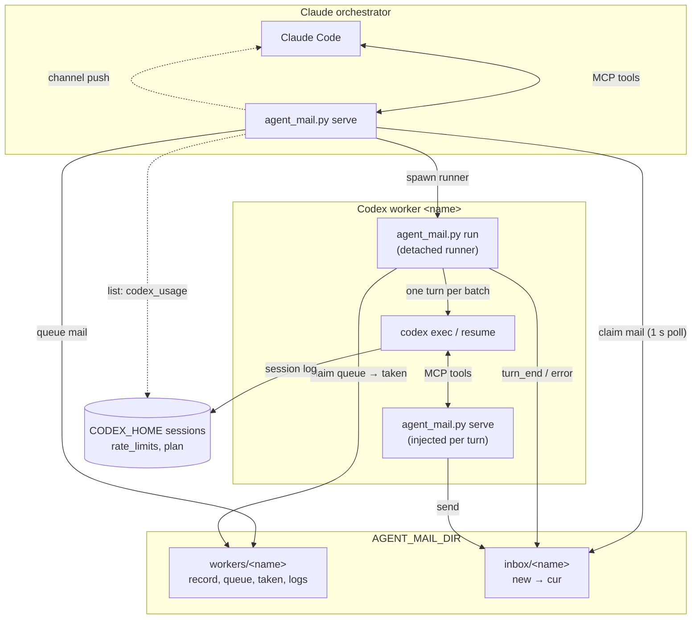
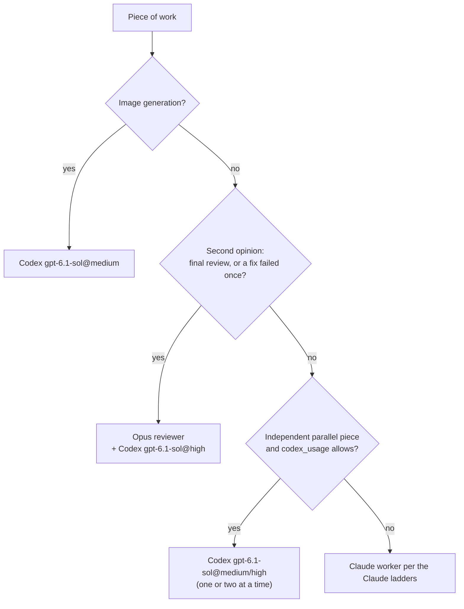
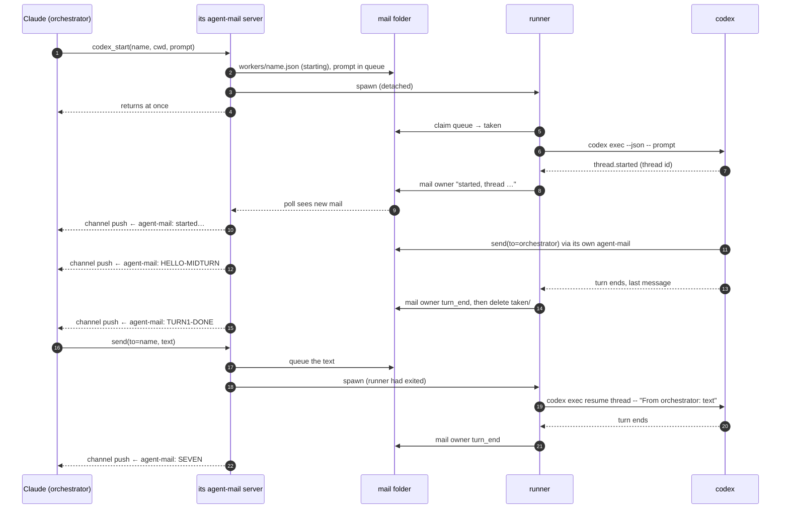
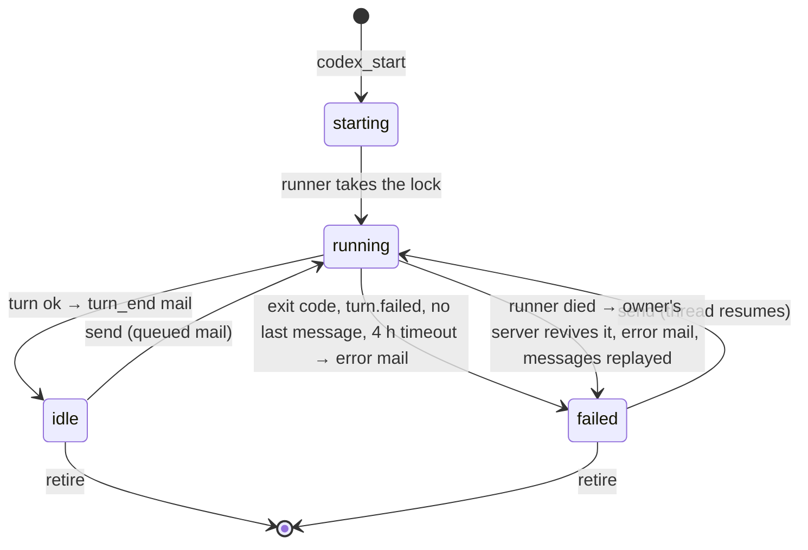

# agent-mail architecture

**TL;DR:** one Python file with two modes, and every session (Claude or Codex) loads the same MCP server. Messages are
files in a shared folder. The orchestrator's server starts a detached runner per Codex worker, the runner drives
`codex exec` / `codex exec resume`, and mails each turn's result back. Claude gets woken through the `claude/channel`
push; Codex reads mail with `inbox`. Tools, environment and registration are in [README.md](README.md).

## The parts

**TL;DR:** three kinds of process, one mail folder.



- **`serve`**: the MCP server, one per session. Claude talks to it over stdio. In a Codex turn it is injected with
  `-c mcp_servers.agent-mail.*`, so Codex's `config.toml` is never touched.
- **`run <name>`**: the runner. It starts in its own session, so a Claude restart or `/mcp` reconnect never kills a
  turn. An `flock` makes sure only one runs per worker, and it exits when the queue is empty.
- **Mail folder**: all state. If any process dies, the files still say what is queued, running and delivered.
- **Codex quota**: `list` reads the last `rate_limits` from the newest Codex session log (ChatGPT plan, 5-hour and
  weekly percent, reset times; a window that has reset since shows 0), so the orchestrator can route by it.

## When an orchestrator picks a Codex worker

**TL;DR:** Codex is the extra hand on a smaller plan: second opinions, images, and a parallel piece when its quota
allows. The rules live in "Codex workers" in the shared `CLAUDE.md`; this is their shape.



| `codex_usage` | Effect |
|---|---|
| Weekly above 75% | One rung down, no parallel Codex pieces |
| Weekly or 5-hour above 90% | No new Codex worker unless the user asks |
| Weekly ≤ 60%, reset ≤ 2 days away, spare ≥ 28%/day | Boost +1 rung (sol@medium → sol@high), one extra parallel piece |
| Missing (no Codex turn yet) | Normal budget, no boost |

`gpt-6-astra` only when the user asks; `xhigh`, `max` and `ultra` only with their OK.

## One round trip

**TL;DR:** start, mail mid-turn, turn result, reply, next turn on the same thread.



This is the exact sequence the end-to-end test ran on the VDI.

## Worker states

**TL;DR:** silence never means success: every turn ends in `turn_end` or `error` mail.



## Delivery rules

**TL;DR:** a rename claims a message, a lock serialises a worker, and a result is mailed before its input is deleted.

| Concern | How it is handled |
|---|---|
| Exactly-once inbox read | Each message is one file in `new/`; a reader claims it with `os.rename` to `cur/`. Two readers can't both win. |
| Push only when it lands | The server pushes only to a `claude-code` client whose parent was started with `--dangerously-load-development-channels server:agent-mail` (checked in `/proc/<ppid>/cmdline`). Otherwise the mail stays for `inbox`. |
| No lost turn | Queue files move to `taken/` for the turn and are deleted only after the result is mailed. A runner that dies leaves them there; the next runner puts them back and mails an `error` first. At-least-once, never zero. |
| Dead runner | The owner's server (push thread, `list`, `inbox`) checks the runner pid and starts a new one. |
| Full environment | Only the worker's owner spawns runners, so every turn gets the orchestrator's env (proxies, `UV_*`, `LOG_PATH`), never the filtered env Codex hands to MCP servers. While the owner is down, its workers' mail waits. |
| Flag injection | The prompt goes after `--`; names allow only letters, digits, `_` and `-` (no dots: `x.rec` would collide with lock files). |
| Retire races | `retire` holds the runner lock, deletes the record and folder, and keeps the lock files, so a runner that opened the lock before still shares it with the next one. `send` re-checks the record under the record lock: mail to a just-retired worker goes to the inbox of that name, never into a dead queue. A runner that finds no record exits without writing one. |
| Restricted workers | `sandbox` defaults to `full` (bypass flag). A `read-only` or `workspace-write` worker can't start a looser one. |

## Mail folder layout

```
$AGENT_MAIL_DIR/
├── tmp/                              each message is written here, then renamed into place
├── inbox/<name>/new/<ns>-<id>.json   unread
├── inbox/<name>/cur/                 claimed
└── workers/
    ├── <name>.json                   record: state, owner, thread_id, cwd, sandbox, pid, turns
    ├── <name>.lock, <name>.rec.lock  runner lock, record lock (kept by retire, reused)
    └── <name>/
        ├── queue/                    messages waiting for the next turn
        ├── taken/                    messages in the running turn
        └── logs/                     runner.log; turn-<n>.jsonl, .last.md, .err
```

## Limits

**TL;DR:** all by design or outside agent-mail's reach.

- **Lock files stay after `retire`**: they keep a runner that opened the lock before the retire and the next runner on
  one lock. Empty files.
- **Sender names are self-declared**: every session runs as one user on one mail folder, so any signing key would be
  readable by every process that could forge mail.
- **Push needs an interactive Claude with `--dangerously-load-development-channels server:agent-mail`**; a `--bg`
  orchestrator reads mail with `inbox`. Claude Code (2.1.318) loads a channel without that flag only for a plugin on
  Anthropic's approved list or on the org's `allowedChannelPlugins` (managed settings, set by an org admin), so shipping
  agent-mail as a plugin would not remove it.
- **`retire` keeps the Codex thread** unless `delete_thread=true`.
- **Kiro** has no MCP channel, so it is not covered.
